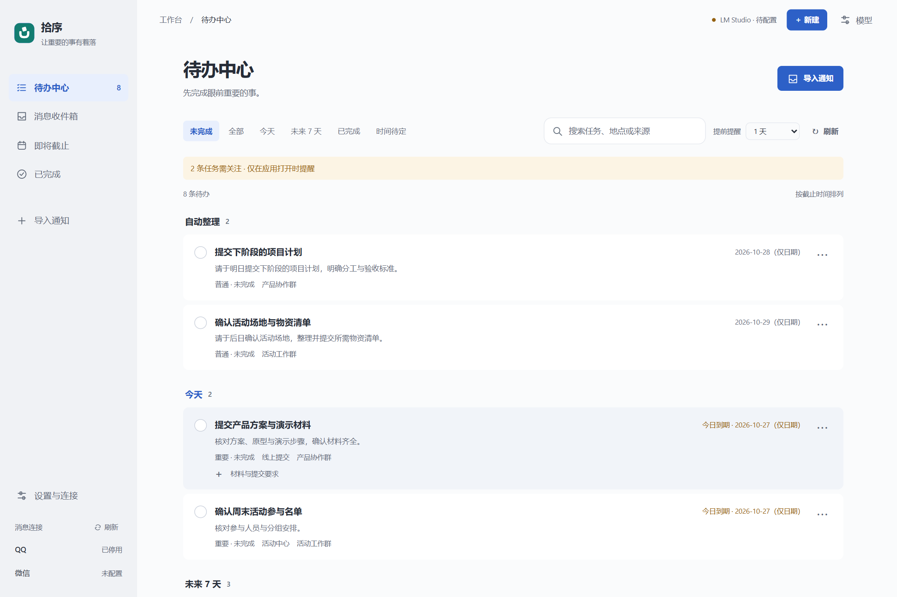
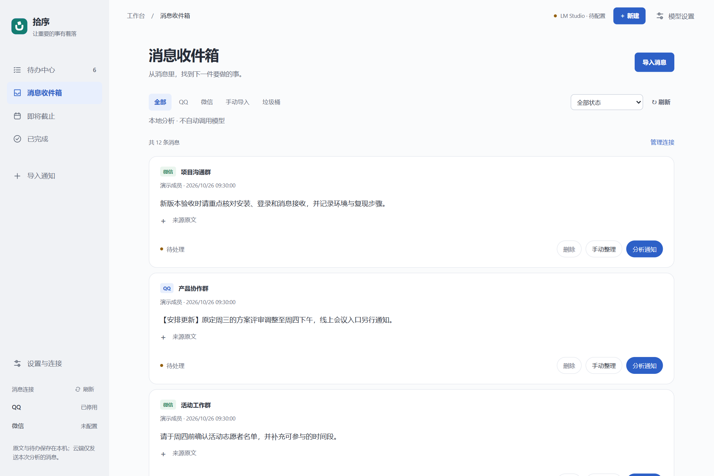
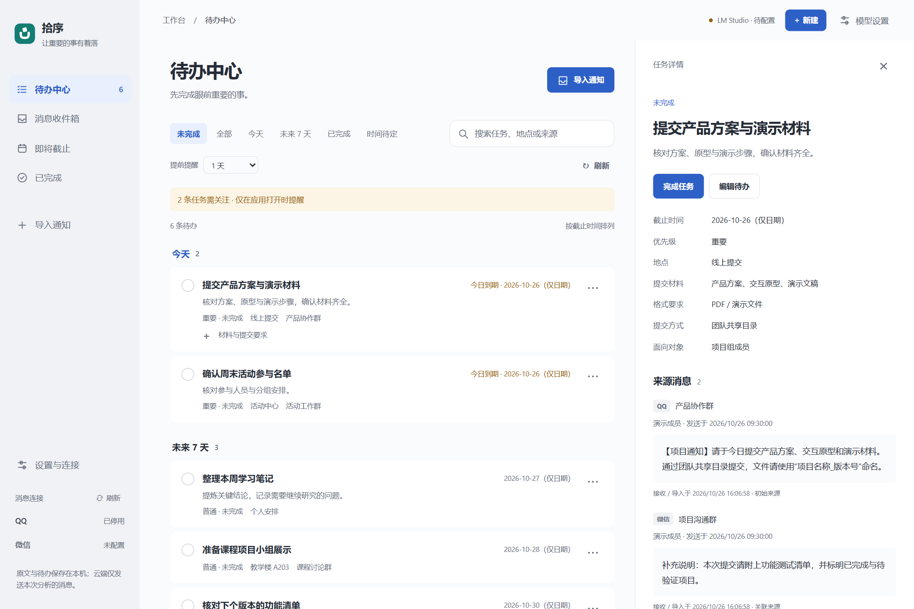
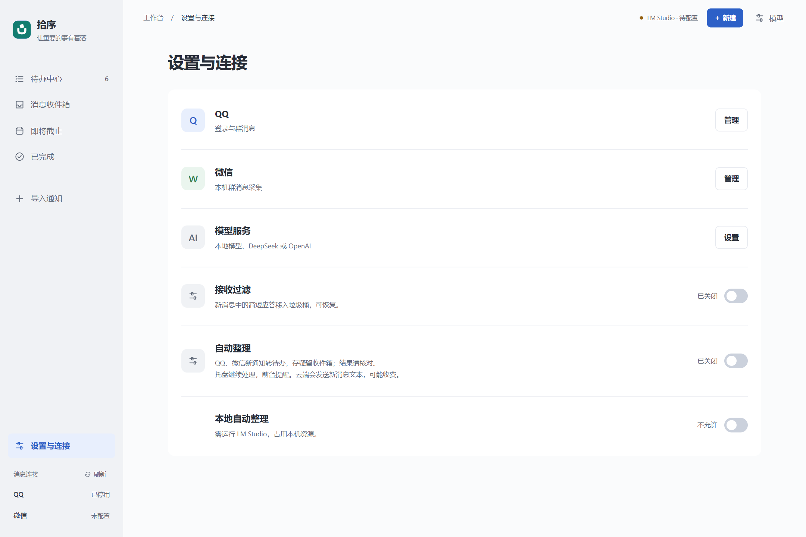
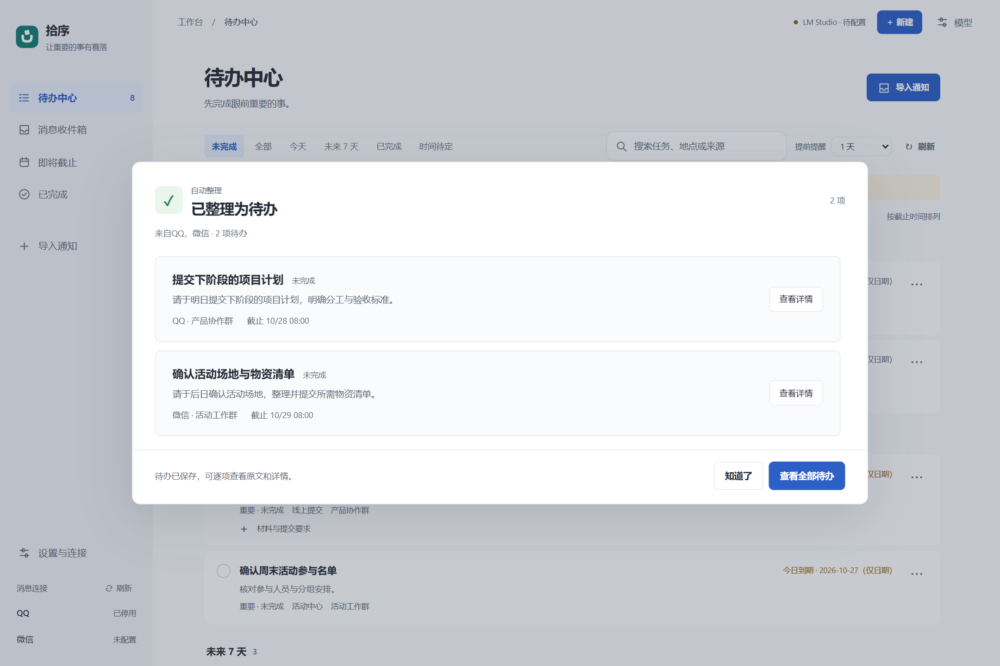

<p align="center">
  
</p>

<p align="center">
  <a href="docs/usage-v1.md"></a>
  <a href="https://github.com/zerbit-nb/ShiXu/releases/latest"></a>
  <a href="LICENSE_SCOPE.md"></a>
</p>

<h1 align="center">拾序 · Shixu</h1>

<p align="center"><strong>让重要的事有着落。</strong></p>
<p align="center">多源消息驱动的智能待办管理助手</p>
<p align="center">本机存储 · 人工核对 · 原文可追溯</p>
<p align="center">
  <a href="https://github.com/zerbit-nb/ShiXu/releases/latest">下载安装包</a> ·
  <a href="#界面预览">界面预览</a> ·
  <a href="docs/usage-v1.md">使用说明</a> ·
  <a href="#从源码运行">从源码运行</a>
</p>

多源消息驱动的智能待办管理助手。将 QQ、微信文本通知与手动导入内容汇入同一收件箱，经模型提取或手动整理、人工核对后生成待办。面向 Windows 10/11 x64，本地单用户运行。



> 截图来自 1.1.0 当前界面，使用虚构演示数据，不含真实聊天或账号。QQ、微信和云端模型未连接；自动整理结果为预置演示，不作为真实接收或模型准确率的证明。

## 从消息到行动

**接收 / 导入 → 分析 / 手动整理 → 核对草稿 → 创建待办 → 跟进与追溯**

| 统一收集 | 核对后创建 | 保留上下文 |
|---|---|---|
| QQ、微信和手动导入汇入同一收件箱 | 提取任务、期限和要求，确认后才保存正式待办 | 查看初始原文、关联来源与通知变更记录 |

## 下载与安装

前往 [Releases 下载页面](https://github.com/zerbit-nb/ShiXu/releases/latest)，下载 **`Shixu-1.1.0-win-x64-Setup.exe`**。GitHub 自动生成的 Source code 压缩包是源码，不是安装包。

- 内置 Python 和 NapCat v4.18.38，无需另装 Python；官方 QQ、微信需自行安装并登录。
- 需要 Microsoft Edge WebView2 Runtime、.NET Framework 4.8。
- 支持选择安装路径；安装结束关闭安装器，再从桌面或开始菜单打开拾序。
- 1.1.0 从系统托盘完整退出即可；1.0 等旧版更新前先在应用中退出 NapCat，再从托盘退出拾序；备份安装目录的 `data`、`runtime` 和 `*.local.json`，选择原目录覆盖安装。
- 安装包未签名，下载后可用 `Get-FileHash ./Shixu-1.1.0-win-x64-Setup.exe -Algorithm SHA256` 与 Release 中的校验值核对。

## 功能

- QQ 与微信文本接收、手动导入及统一消息收件箱。
- LM Studio 本地文本模型、DeepSeek / OpenAI 官方文本 API。
- 人工核对草稿后创建待办；任务编辑、完成、恢复、取消和删除。
- 疑似重复核对、关联原文、通知确认的期限更新与取消历史。
- 可恢复消息垃圾桶；可开关短应答接收过滤，默认关闭。
- QQ 登录与退出、连接状态、内置 NapCat 管理和脱敏诊断。
- 桌面窗口、托盘收起与完整退出；完整退出清理本安装关联的 NapCat。
- 可开关自动整理待办，默认关闭，本地模型单独许可；托盘继续处理、前台合并提醒。云端自动整理会发送新消息文本并可能产生费用，AI 结果仍需核对。

**1.1.0 新增可开关自动整理待办，并修复托盘退出后的 NapCat 清理。图片、文件分析尚未实现；各电脑和客户端版本兼容性仍需现场验证。**

## 界面预览

### 消息收件箱：先收集，再决定

按 QQ、微信和手动导入筛选，保留来源与处理状态。主动分析或手动整理，无用消息可移入可恢复垃圾桶。



### 任务详情：知道做什么，也知道为什么

在列表旁查看期限、材料与提交要求，同时追溯 QQ 初始通知和微信补充说明。任务与原始消息保持关联。



### 设置与连接：集中管理接收方式

集中管理 QQ、微信、模型与接收过滤，按需开启自动整理及本地模型许可。截图保留未配置状态，不展示登录二维码或凭证。



### 自动整理：后台处理，前台核对

开启后，明确通知可生成待办，存疑内容留在收件箱。收起到托盘时继续处理，打开界面后集中提醒；待办中心的“自动整理”临时分组便于逐项查看。



## 使用

1. 打开“设置与连接”，配置 QQ 或微信。QQ 由本人扫码或授权，保存目标群后接收新文本；微信需登录本机客户端，填写当前微信号及群名后主动开启采集。
2. 如需模型分析，选择 LM Studio、DeepSeek 或 OpenAI，配置并检测模型。模型未配置时可手动整理。API 服务需要自己的账户和额度。
3. 在收件箱选择消息分析或手动整理，核对标题、期限和原文，确认后创建待办。自动整理默认关闭，开启后仅处理新增 QQ、微信文本。
4. 如需减少短应答，开启“接收过滤”。完整匹配“收到”“好的”“谢谢”等的新增 QQ/微信消息移入垃圾桶，可恢复；并非通用闲聊识别。
5. 关闭窗口会收起到托盘；结束运行请使用托盘“退出拾序”。1.1.0 完整退出会停止后台并清理本安装关联的 NapCat；清理失败会提示重试。

## 技术栈与目录

Python 3.12、FastAPI、SQLite、原生 HTML/CSS/JavaScript、pywebview/WebView2、Windows 托盘及 Inno Setup。无 React 或前端构建步骤。

```text
app/                  API、数据与业务服务、静态界面
scripts/              桌面启动、采集子进程、诊断与工具
tests/                单元/API 测试及隔离浏览器测试
third_party/wechat_db/ 固定版本只读微信数据库模块及许可
packaging/            安装器、依赖打包与 NapCat 许可
assets/brand/windows/ Windows 图标
docs/                 使用、发布及第三方资源说明
```

内部 `CampusFlow` 标识、数据库名和启动文件名保留，以兼容原配置。

## 从源码运行

在 Windows 上安装 64 位 Python 3.12，在仓库目录执行：

```powershell
py -3.12 -m venv .venv
./.venv/Scripts/python.exe -m pip install -r requirements.txt -r requirements-desktop.txt -r requirements-wechat.txt
./.venv/Scripts/python.exe -B scripts/desktop_window.py
```

也可双击 `StartCampusFlowDesktop.vbs`。仅使用本地浏览器界面时运行：

```powershell
./.venv/Scripts/python.exe -B scripts/launch.py
```

服务仅监听 `http://127.0.0.1:8000`；安装版和源码版不能同时占用该端口。源码快照不含 NapCat 二进制；需要按 [构建说明](packaging/README.md) 获取固定官方包并构建安装包，或按 NapCat 官方指南单独安装配置。普通使用者优先下载安装包。

## 测试

```powershell
./.venv/Scripts/python.exe -m pytest -q
```

Python 测试使用临时数据库和替身，不代表真实模型准确率或真实群兼容性。浏览器测试额外需要 Node.js、Playwright 和 Chrome；例如 `node tests/browser_reception_filter.cjs`。浏览器脚本默认使用标准 Chrome 路径，部分支持 `CAMPUSFLOW_BROWSER`；这些脚本主要针对 Windows。构建及发布验证见 [构建说明](packaging/README.md)。

## 数据与隐私

消息、草稿和待办保存在本机 `data/campusflow.sqlite3`；配置位于 `*.local.json`，日志及会话位于 `runtime/`。停止服务后再备份。Windows 保存的 API 密钥使用当前用户 DPAPI 保护，换用户后需重新配置。

手动云端分析会发送选中的文本；开启云端自动整理后，会自动发送新增 QQ、微信消息文本，可能产生费用。不要公开数据库、配置、日志、截图中的聊天或登录二维码。使用仅限自己有权访问的账户和群。详见 [安全说明](SECURITY.md)。

## 已知限制

- QQ 使用第三方 NapCat/OneBot 11，受官方客户端版本、登录验证及账号策略影响。
- 微信使用本机已登录账号的只读数据库适配，涉及进程内只读密钥获取及本地数据库解密，不是微信官方消息接口；受客户端版本、权限、存储状态影响，不能保证跨机通用。
- 通知分析结果可能有误，务必核对期限与适用对象；页面和服务关闭时不保证提醒。
- 暂不支持移动端、图片/文件解析、历史消息批量采集或系统级离线提醒。

## 来源与许可

项目原创源代码及随附文档，除另有说明外，采用 [Apache-2.0](LICENSE.md)。使用、修改和再分发应遵守许可证，保留相关声明并注明文件修改，详见 [许可适用范围](LICENSE_SCOPE.md) 和 [NOTICE](NOTICE)。

第三方资源继续遵守各自原许可，见 [第三方资源说明](THIRD_PARTY_NOTICES.md)。内置 NapCat 受有限再分发许可及非商业用途限制，**不能因原创代码采用 Apache-2.0，就将含 NapCat 的完整安装包视为可自由商用或统一授权**。本次许可变更不改写旧版发布制品。
